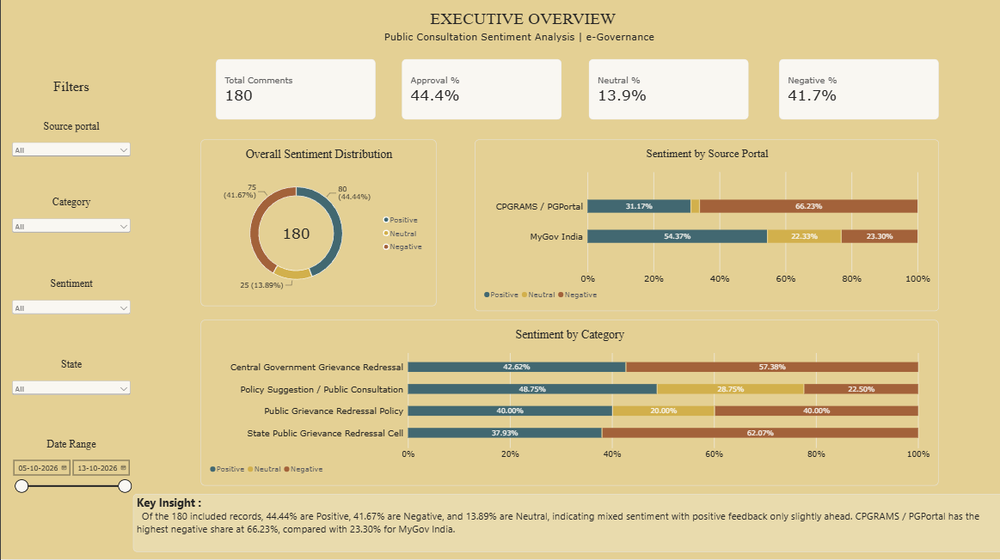

# Public Consultation & Grievance Sentiment Analysis (e-Governance)

An end-to-end NLP and LLM-powered sentiment analysis pipeline for citizen feedback across Indian e-governance platforms, specifically **MyGov India** (policy consultation) and **CPGRAMS / PGPortal** (grievance redressal).

---

## Project Overview

Citizen engagement platforms generate critical qualitative feedback for public policy and administrative governance. This project automates the ingestion, normalization, and sentiment classification of citizen feedback:

- **Data Ingestion & ID Unification**: Consolidates scraped consultation records and grievance tickets into unified identifiers.
- **NLP Text Preprocessing**: Strips emojis, expands contractions, removes noise, filters domain-safe stopwords (preserving negation and governance whitelists), and applies WordNet lemmatization.
- **LLM Sentiment Classification**: Leverages Groq-hosted LLMs with strict Pydantic structured output validation to classify sentiment into `positive` (+1), `neutral` (0), and `negative` (-1).
- **Analytics & Executive Dashboard**: Explores sentiment distribution, portal comparison, category trends, and citizen engagement via Python visualizations and an executive Power BI dashboard.

---

## Project Directory Structure

```text
├── assets/
│   └── dashboard_overview.png         # Power BI Executive Overview dashboard snapshot
├── data/
│   ├── raw/                           # Raw ingested data
│   │   ├── mygov_scraped_dataset.json
│   │   ├── pgportal_scraped_dataset.json
│   │   └── master_combined_dataset.json
│   └── processed/                     # Cleaned, tokenized, and lemmatized data
│       ├── preprocessed_comments.json
│       └── preprocessed_comments.csv
├── notebooks/
│   └── Visualization.ipynb            # Exploratory Data Analysis & visual plots
├── outputs/                           # Final sentiment-analyzed datasets (ready for BI)
│   ├── sentiment_analyzed_comments.json
│   └── sentiment_analyzed_comments.csv
├── src/                               # Modular Python pipeline source code
│   ├── id_generator.py                # Resolves overlapping IDs and unifies raw datasets
│   ├── preprocess_pipeline.py         # Text cleaning, normalization, and lemmatization
│   └── llm_sentiment_analyzer.py      # LLM sentiment classification via Groq & Pydantic
├── .env.example                       # Example environment file template
├── .gitignore                         # Git ignore rules (protects .env and secrets)
└── README.md                          # Project documentation
```

---

## Environment Setup

1. Copy `.env.example` to create your local `.env`:
   ```bash
   cp .env.example .env
   ```
2. Add your Groq API key in `.env`:
   ```env
   GROQ_API_KEY=your_groq_api_key_here
   ```
   *(The `.env` file is protected and excluded from version control by `.gitignore`)*

---

## Pipeline Workflow & How to Run

### 1. ID Generation & Dataset Merging
Assigns continuous, non-overlapping IDs across portal datasets and builds the unified master raw dataset:
```bash
python src/id_generator.py
```
*Output: `data/raw/master_combined_dataset.json`*

### 2. NLP Data Preprocessing
Cleans raw text, handles missing fields, expands contractions, removes web noise/emojis, and lemmatizes tokens while preserving critical governance terms and negations:
```bash
python src/preprocess_pipeline.py
```
*Output: `data/processed/preprocessed_comments.json` & `.csv`*

### 3. LLM Sentiment Classification
Performs zero-shot sentiment inference using Groq API with structured JSON schema validation:
```bash
python src/llm_sentiment_analyzer.py
```
*Output: `outputs/sentiment_analyzed_comments.json` & `.csv`*

### 4. Visualization & Reporting
- Open and run `notebooks/Visualization.ipynb` to generate Seaborn/Matplotlib distribution charts and word clouds.
- Import `outputs/sentiment_analyzed_comments.csv` into Power BI to interact with the executive dashboard.

---

## Executive Overview Dashboard



### Key Insights Summary:
- **Overall Sentiment**: 44.4% Positive (80 comments), 41.7% Negative (75 comments), and 13.9% Neutral (25 comments).
- **Portal Comparison**:
  - **CPGRAMS / PGPortal**: Highest negative sentiment share (**66.23%**), reflecting service delivery complaints and administrative delays.
  - **MyGov India**: Highest positive sentiment share (**54.37%**), reflecting citizen support and constructive policy consultation.
- **Top Categories**: Public Grievance Redressal, Central & State Redressal Cells, and Policy Suggestions.
